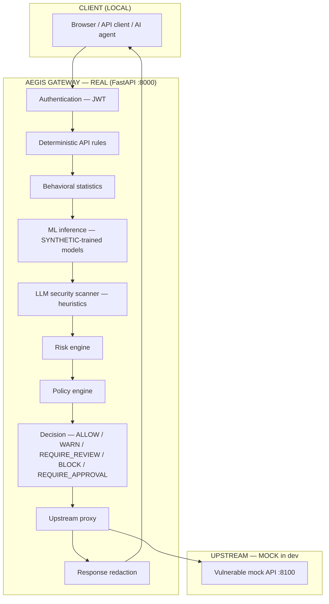
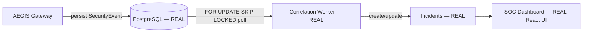
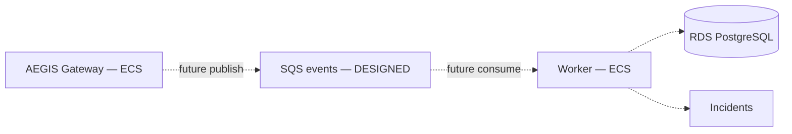
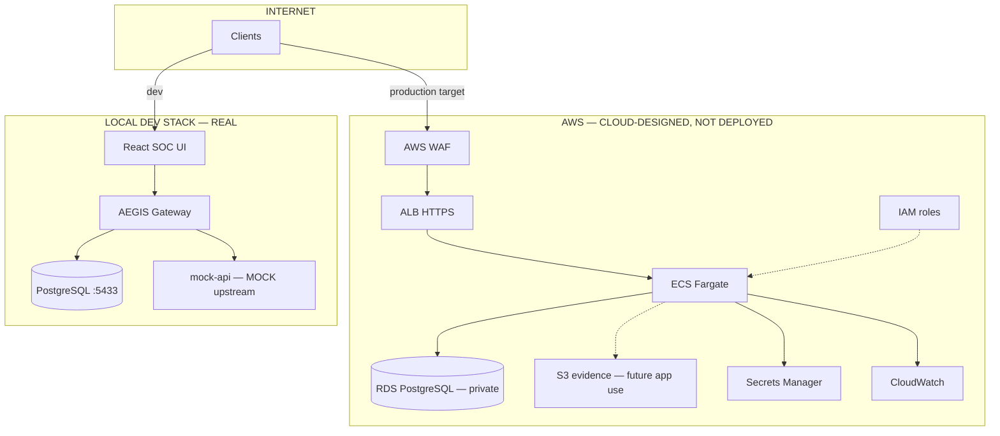

# AEGIS Architecture

## Overview

AEGIS is a security gateway that inspects API and LLM traffic before forwarding to an upstream application. Enforcement is **synchronous**; incident correlation is **asynchronous**.

---

## Request inspection pipeline (LOCAL — implemented)

**Legend:** REAL = running code · MOCK = deliberately vulnerable test upstream · SYNTHETIC = ML trained on generated data

---

## Async incident path

### LOCAL (what runs today)

### CLOUD-DESIGNED (Terraform only — not deployed, app not wired)

Dashed lines indicate **designed but not implemented in application code**. The worker today polls PostgreSQL directly, not SQS.

---

## Full system context

---

## Component status

| Component | Role | Status |
|-----------|------|--------|
| `backend/app/gateway` | Request inspection pipeline | **REAL** |
| `backend/app/api` | Control-plane REST API | **REAL** |
| `backend/app/worker` | Incident correlation (DB poll) | **REAL** |
| `backend/app/ml` | Isolation Forest + Random Forest | **REAL** (SYNTHETIC training) |
| `backend/app/security/llm` | Prompt/output scanning | **REAL** (MOCK upstream echo) |
| `frontend` | SOC dashboard | **REAL** |
| `attack_lab` | 16 adversarial scenarios | **REAL** |
| `attack_lab/targets/mock_api` | Test upstream | **MOCK — never for production** |
| Terraform modules | VPC, ALB, ECS, RDS, S3, SQS, WAF | **CLOUD-DESIGNED — not deployed** |

---

## Decision path vs async path

**Synchronous (must complete before response):** authentication, rules, behavioral stats, ML inference, LLM scan, risk aggregation, policy evaluation, upstream forward, response inspection.

**Asynchronous (does not affect enforcement):** security event persistence, incident correlation, some audit writes.

Security decisions are **never** delegated to the worker or SQS.

---

## Frontend

React + Vite SPA. Dashboard metrics from `/api/analytics/*`, `/api/events`, `/api/incidents`. The UI is an operator console, not a security boundary.

---

## Related docs

- [AWS_DEPLOYMENT.md](AWS_DEPLOYMENT.md) — cloud topology
- [CLOUD_SECURITY.md](CLOUD_SECURITY.md) — network and IAM
- [THREAT_MODEL.md](THREAT_MODEL.md) — trust boundaries
- [PERFORMANCE.md](PERFORMANCE.md) — measured local overhead
