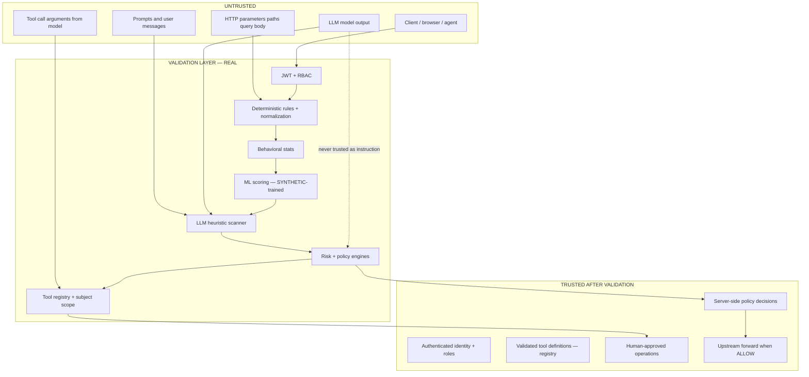

# AEGIS Final Project Report

**Date:** 2026-08-13  
**Status:** FEATURE FREEZE ACTIVE  
**Classification:** PRODUCTION-ORIENTED PROTOTYPE

Evidence supports a strong security-engineering demonstration. It does **not** support claims of production deployment, real-world ML accuracy, or complete attack coverage.

---

## 1. Executive summary

AEGIS is an **AI-powered API and LLM security gateway**: a FastAPI service that inspects HTTP traffic through layered detection (rules, behavior, ML, LLM heuristics, risk, policy) before forwarding to an upstream application. It adds **AI-agent tool authorization**, **human approval workflows**, **async incident correlation**, and a **React SOC dashboard**.

Built and verified as a **production-oriented prototype** — real enforcement code, mock upstream, synthetic ML, Terraform cloud design **not applied** to AWS.

**Strongest story:** Unified API + LLM attack surface → security gateway → layered detection → ML scoring → policy/risk → agent authorization → automated response → incident correlation → SOC dashboard → cloud deployment design.

---

## 2. Architecture

See [ARCHITECTURE.md](../ARCHITECTURE.md).

- **Sync path (REAL):** Client → JWT → rules → behavior → ML → LLM scan → risk → policy → decision → upstream → redaction  
- **Async path (REAL):** Security events → PostgreSQL → worker (`FOR UPDATE SKIP LOCKED`) → incidents → dashboard  
- **Cloud (DESIGNED, NOT DEPLOYED):** WAF → ALB → ECS → RDS; S3/SQS in Terraform only

### Trust boundaries



**Invariant:** The LLM remains **UNTRUSTED**. Output and tool calls are inspected; they never bypass policy or approval.

---

## 3. API security

| Capability | Status |
|------------|--------|
| SQLi, SSRF, cmd injection, traversal | **REAL** — regex + decode pipeline |
| BOLA on modeled routes | **REAL** — post-forward ownership check |
| Rate limiting + enumeration | **REAL** — behavioral rules |
| JWT auth + RBAC | **REAL** |
| 16 attack scenarios | **16/16 PASS** (controlled lab) |
| 15 encoding bypass tests | **15/15 PASS** (prior verified run) |

---

## 4. LLM security

| Capability | Status |
|------------|--------|
| Prompt heuristic scanner | **REAL** |
| Output redaction | **REAL** |
| Mock provider (default) | **MOCK** |
| Real OpenAI-compatible provider | **REAL** — opt-in (`LLM_PROVIDER=real`) |
| Provider failure handling | **REAL** — 502/503; deterministic controls continue |
| Adversarial test suites | **REAL** — prompt + output |

Does **not** claim secure against all prompt injection or zero false positives.

---

## 5. Agent security

| Capability | Status |
|------------|--------|
| Tool registry | **REAL** |
| Role + permission checks | **REAL** |
| Cross-subject blocking | **REAL** |
| REQUIRE_APPROVAL workflow | **REAL** |
| Duplicate approval prevention | **REAL** — HTTP 409 after first decide |

---

## 6. ML

| Aspect | Status |
|--------|--------|
| V1 pipeline (API train) | **REAL** — synthetic data |
| V2 evaluation (temporal split, baselines) | **REAL** — controlled local telemetry |
| Online inference fail-safe | **REAL** — `ml_available=false` excludes ML weight |
| Drift monitoring (basic) | **REAL** — rolling window alerts |
| Production accuracy | **NOT CLAIMED** — see [ML_V2_EVALUATION.md](../ML_V2_EVALUATION.md) |

---

## 7. Incident response

| Capability | Status |
|------------|--------|
| Security event persistence | **REAL** |
| Correlation worker | **REAL** |
| MITRE-tagged incidents | **REAL** |
| Duplicate incident suppression | **REAL** — tested |
| Response actions engine | **REAL** — idempotent handlers |

---

## 8. Frontend

| Capability | Status |
|------------|--------|
| React SOC dashboard | **REAL** |
| Incidents, approvals, ML, audit views | **REAL** |
| Vitest | **7/7 PASS** |
| Production build | **PASS** |

---

## 9. Docker

| Item | Status |
|------|--------|
| Compose stack (postgres, mock-api, backend, worker) | **REAL** |
| Frontend profile | **REAL** — `:3000` |
| Non-root containers, health checks | **REAL** |
| Seed on backend startup | **FIXED** this validation phase |
| Full stack live test this session | **BLOCKED** — Docker daemon not running on host |

---

## 10. Cloud architecture

| Item | Status |
|------|--------|
| Terraform modules (VPC, ECS, RDS, S3, SQS, WAF) | **DESIGNED** |
| `terraform apply` | **NOT RUN** |
| S3/SQS in application | **NOT IMPLEMENTED** — worker uses PostgreSQL |
| AWS deployment | **NOT DEPLOYED** |

See [AWS_DEPLOYMENT.md](../AWS_DEPLOYMENT.md), [CLOUD_READINESS_REPORT.md](CLOUD_READINESS_REPORT.md).

---

## 11. CI/CD

GitHub Actions: backend (pytest, ruff, mypy), frontend (vitest, build), terraform validate, Docker build, **blocking attack-lab job**, security scanners.

---

## 12. Testing

| Suite | Result (2026-08-13 validation) |
|-------|--------------------------------|
| Backend pytest | **220 collected**, **219 pass** without Postgres; **220/220** with clean DB |
| Ruff | **PASS** (after ML V2 lint fixes) |
| Mypy | **PASS** — 96 source files |
| Frontend | **7/7 PASS** |
| Attack lab | **16/16** — artifact 2026-08-13 |
| Bypass | **15/15** — prior verified run |
| Docker live rehearsal | **BLOCKED** — Docker stopped |

See [FINAL_TEST_MATRIX.md](FINAL_TEST_MATRIX.md).

---

## 13. Attack lab

16 scenarios covering auth brute force, API injection, BOLA, LLM abuse, tool abuse, approval workflow. All **PASS** against controlled mock upstream.

Artifact: [attack_lab_results.json](attack_lab_results.json)

---

## 14. Performance

**Recheck this session:** **NOT RUN** — requires Docker + running stack (unavailable on validation host).

**Prior benchmark (2026-08-12, identical methodology):** `backend/scripts/loadtest.py`, 100 serial requests, 20 concurrent workers, benign path `GET /api/gateway/api/public/products`.

| Tier | p50 | p95 | p99 | req/s |
|------|-----|-----|-----|-------|
| Upstream (no AEGIS) | 3.7ms | — | 4.6ms | ~64 |
| AEGIS gateway | ~215ms | ~250ms | ~267ms | ~4.3 |
| AEGIS + ML | ~216ms | ~243ms | ~269ms | ~4.3 |
| AEGIS LLM route | ~218ms | ~251ms | ~263ms | ~4.3 |
| Concurrent (20w) | ~4047ms | ~5832ms | ~6923ms | ~4.7 aggregate |

ML inference adds ~0.1ms; DB aggregation dominates. Full methodology: [PERFORMANCE.md](../PERFORMANCE.md).

---

## 15. Security findings (validation phase)

| Finding | Severity | Action |
|---------|----------|--------|
| README omitted database seed step | Doc | **Fixed** |
| Docker compose omitted seed | Repro | **Fixed** |
| Duplicate in-process + container worker | Ops | **Fixed** — `AEGIS_IN_PROCESS_WORKER=false` on backend service |
| `/health` does not probe Postgres | Info | **Documented** |
| Postgres integration test fails when DB down | Test env | Expected; CI uses fresh Postgres |

---

## 16. Fixed vulnerabilities (historical)

| ID | Issue | Fix |
|----|-------|-----|
| F1 | New TCP connection per upstream request (~600ms forward) | Shared httpx client + `127.0.0.1` default |
| F2 | Benchmark path 404 triggered enumeration cascade | Mock exposes `/api/public/products` |
| — | ML error treated as low risk | `ml_available` gate in risk engine |
| — | V2 train split single-class crash | Traffic generator temporal shuffle |

---

## 17. Limitations

See [LIMITATIONS.md](../LIMITATIONS.md). Summary:

- **SYNTHETIC** ML — not production traffic  
- **MOCK** LLM default — real provider opt-in  
- **Heuristic** detection — encoding evasion ongoing  
- **~4 req/s** per worker — not production capacity  
- **16 scenarios** — not all attacks  
- **NOT DEPLOYED** to AWS  

---

## 18. Deployment status

| Target | Status |
|--------|--------|
| Local venv + Docker deps | **DOCUMENTED** — seed step added |
| Docker Compose full stack | **READY** — not live-tested this session |
| AWS | **NOT DEPLOYED** — Terraform validate only |

Rehearsal: [DEPLOYMENT_REHEARSAL_REPORT.md](DEPLOYMENT_REHEARSAL_REPORT.md)

---

## 19. Final classification

**PRODUCTION-ORIENTED PROTOTYPE**

| Criterion | Evidence |
|-----------|----------|
| Real synchronous enforcement | Gateway pipeline + 16/16 attack lab |
| Real async correlation | Worker + incident tests |
| Real SOC UI | Frontend on live APIs |
| Production deployment | **No** — not on AWS |
| Production ML | **No** — synthetic / controlled local eval |
| Production LLM default | **No** — mock provider |
| Capacity | **No** — ~4 req/s measured locally |

Stronger claims (production-ready, deployed WAF, real-world ML accuracy) are **not supported** by evidence.

---

## Documentation audit (unsupported claims)

Searched for: "production-ready", "100% detection", "zero false positives", "secure against all attacks", "real-world accuracy".

| Location | Finding |
|----------|---------|
| README | Correctly states **not production-ready** |
| REAL_LLM_INTEGRATION.md | Lists non-claims explicitly |
| ML_V2_EVALUATION.md | FPR=0 qualified as **synthetic test slice only** |
| RELEASE_GATE_REPORT.md | Correctly denies production-ready |

No unsupported superlatives require removal.

---

## Git audit (2026-08-13)

```
git log --oneline -5:
0bb2659 chore: finalize AEGIS portfolio release
9b8ce95 docs: record initial commit hash in CI security report
9ccbc78 feat: establish AEGIS security gateway platform
```

| Check | Result |
|-------|--------|
| Secrets in tracked files | **None** — test placeholders only |
| `.env` committed | **No** — gitignored |
| `node_modules/` | **No** — gitignored |
| `*.joblib` / models | **No** — gitignored |
| `__pycache__` / `.venv` | **Untracked** — gitignored |
| Local DB files | **None** tracked |

Uncommitted work: LLM integration, ML V2, validation docs (expected pre-commit state).

---

## Feature freeze policy

After this report, only:

- Security vulnerabilities  
- Correctness bugs  
- Reproducibility issues  
- Documentation inaccuracies  

No new features, dashboards, microservices, or resume-driven scope expansion.

---

**FEATURE FREEZE: ACTIVE**

Related: [FINAL_SECURITY_MATRIX.md](FINAL_SECURITY_MATRIX.md) · [FINAL_TEST_MATRIX.md](FINAL_TEST_MATRIX.md) · [ML_V2_EVALUATION.md](../ML_V2_EVALUATION.md)
